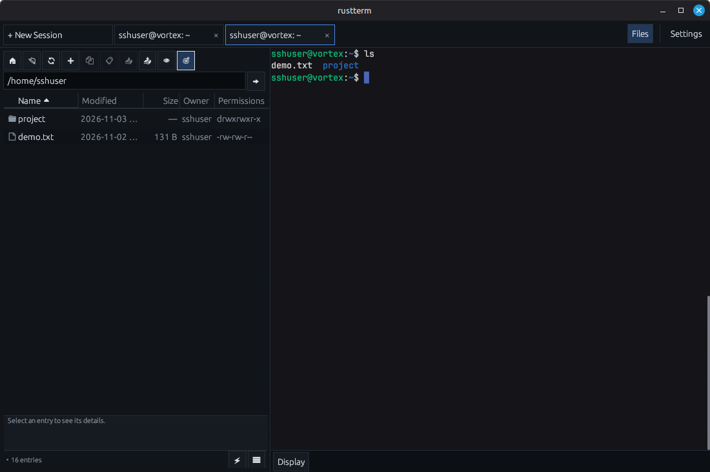
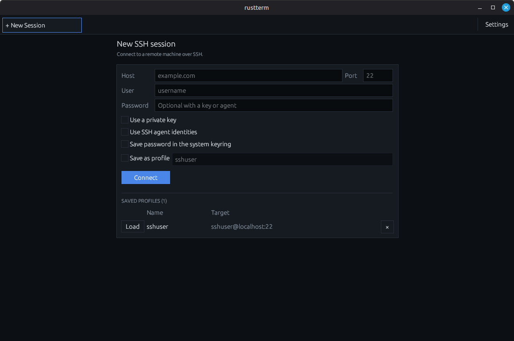
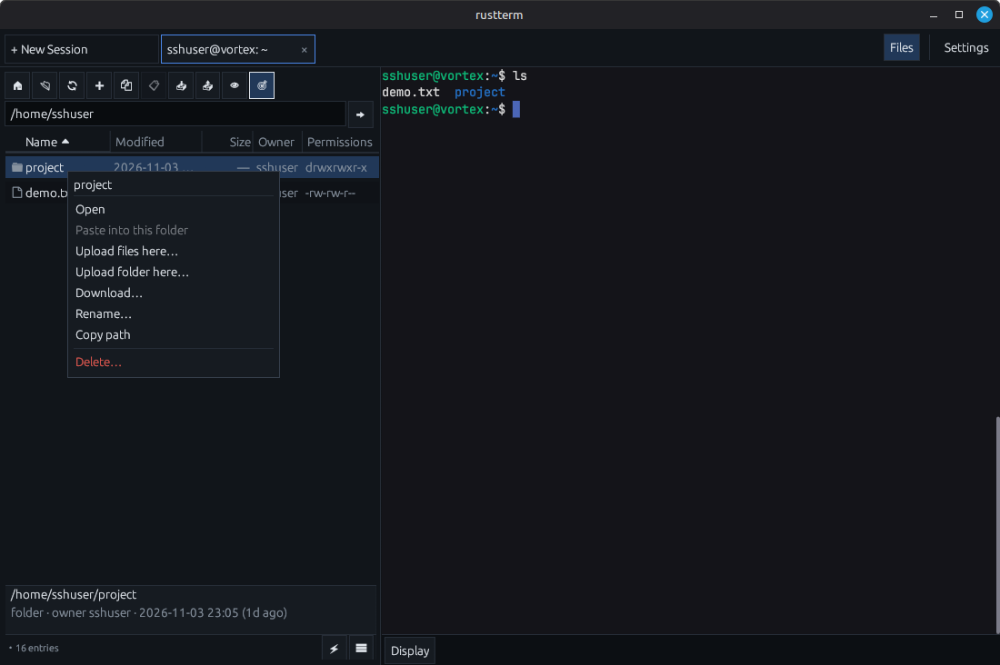

# rustterm

[](https://github.com/anugcodes/rustterm/actions/workflows/ci.yml)
[](LICENSE)
[](https://www.rust-lang.org)

A fast, lightweight, native Linux alternative to MobaXterm. SSH terminal tabs with an SFTP side panel that follows your session. Written in Rust.

> **Status:** **v1.0.0**. SSH terminal tabs with 256-colour output, scrollback,
> copy/paste, mouse reporting, TOFU host keys, saved profiles, keyring/key/agent
> auth and an SFTP side panel are done. The panel follows the shell's `cd`,
> supports recursive drag-and-drop upload/download with a queue and conflict
> prompts, edit-and-auto-upload surviving reconnects, multi-select with bulk
> download/delete/open, a Permissions column, and a bundled JetBrains Mono
> terminal font. X11 forwarding and a VNC tunnel cover remote GUI tools. The
> post-1.0 roadmap (permissions editor, macros/plugins, concurrent transfers, …)
> is in `docs/handoff.md` §11.15 and `docs/ROADMAP.md`.

## Screenshots



| New SSH session | SFTP file actions |
|---|---|
|  |  |

## Features

- [x] SSH terminal with 256-colour support, background colours and reverse video
- [x] Multiple sessions in tabs
- [x] Scrollback (mouse wheel + `Shift+PageUp` / `PageDown` / `Home` / `End`)
- [x] Copy/paste: mouse selection, `Ctrl+Shift+C` / `Ctrl+Shift+V`, right-click menu
- [x] Mouse reporting for full-screen apps (htop, vim, tmux, mc)
- [x] Application cursor keys (DECCKM) so ncurses programs get real arrow keys
- [x] Host-key verification (TOFU) against `~/.ssh/known_hosts`
- [x] Saved profiles + optional system-keyring passwords
- [x] Public-key and ssh-agent authentication
- [x] SFTP side panel per session: **Name / Modified / Size / Owner /
      Permissions** table with header-only column resizing, multi-select
      (Ctrl/Shift), bulk download/delete/open, and a bundled JetBrains Mono
      terminal font
- [x] SFTP message status bar with history and per-operation progress
- [x] SFTP reconnect without dropping the terminal
- [x] SFTP rename, delete, new folder, copy/paste and file operations
- [x] Open remote files in a local editor via an **Open with…** picker
      (`$VISUAL`/`$EDITOR`, Zed, gvim, VS Code, desktop default, custom command)
- [x] Compact New Session page: one connection card with an optional
      **Save as profile** field and a **Load / delete** saved-profile table
- [x] Flat, boxy UI (square corners, 1 px borders, no shadows or hover glow)
- [x] Global UI themes (Midnight / Graphite) with the choice persisted
- [x] SFTP panel follows the shell's working directory
- [x] Upload/download with drag and drop
- [x] Edit-and-auto-upload remote files
- [x] X11 forwarding / VNC tunnel for GUI tools (Verdi, DVE)

## Stack

| Concern | Crate |
|---|---|
| UI | `egui` + `eframe` (hand-rolled SFTP table) |
| SSH | `russh` (pure Rust) |
| SFTP | `russh-sftp` |
| Terminal | `alacritty_terminal` |
| Async | `tokio` |
| Timestamps | `chrono` |

## Prerequisites

Building from source requires:

- **Rust stable and Cargo** — install with [rustup](https://rustup.rs). CI
  builds with Rust 1.99.1.
- Linux build dependencies:
  ```bash
  sudo apt install libxcb-render0-dev libxcb-shape0-dev libxcb-xfixes0-dev libxkbcommon-dev libssl-dev
  ```
- A C linker and `pkg-config` (usually installed with the toolchain).
- X11 or Wayland with OpenGL; D-Bus is only needed for the optional system
  keyring.

No prebuilt binaries are published yet, so installing currently means building
from source. Once release binaries exist, running one will not require Rust or
Cargo.

## Build

```bash
cargo build --release --locked
```

Run the local binary with:

```bash
cargo run --release --locked
```

From the app, enter a host, port, username, and password, then click
**Connect**.

## Install (user-local)

```bash
./install.sh
```

This builds the release binary with `--locked`, then installs the binary to
`~/.local/bin`, the launcher to `~/.local/share/applications`, and the icon to
`~/.local/share/icons`. For a system-wide prefix, use
`PREFIX=/usr/local ./install.sh` (the prefix must be writable by your user).

To remove it:

```bash
./install.sh --uninstall          # binary, launcher and icon
./install.sh --uninstall --purge  # also ~/.config/rustterm (settings, profiles)
```

Passwords stored in the desktop keyring are managed by the keyring itself and
are not removed by the script.

## Documentation

- [`docs/USAGE.md`](docs/USAGE.md) — how each feature works, plus a manual test
  checklist.
- [`docs/TESTING.md`](docs/TESTING.md) — the manual smoke and full test
  procedures.
- [`docs/handoff.md`](docs/handoff.md) — architecture, status and development
  history.

## Roadmap

See [`docs/ROADMAP.md`](docs/ROADMAP.md) for the post-1.0 plan.

## License

MIT
